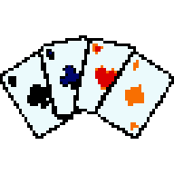

  
  &nbsp;&nbsp;
  

# TximTxom

A card game for 2 to 4 players in the browser. Group your 7 cards into pairs, trios, quads and straights; ungrouped cards count as points, and the lowest total wins.

Can be played here: https://badjuice.github.io/tximtxom/

Rules: [docs/RULES.md](docs/RULES.md) · Changes: [CHANGELOG.md](CHANGELOG.md)

The room creator's browser hosts the game; other players connect to it over WebRTC ([PeerJS](https://peerjs.com)). There is no game server.

## Credits

| For | What | By | Licence / notes |
| --- | --- | --- | --- |
| Game | TximTxom | [BadJuice](https://github.com/badjuice) |  |
| Music | TximTxom Theme | [BadJuice](https://github.com/badjuice) | Made with [Suno](https://suno.com) |
| Art | Playing Cards Pack | [Kenney](https://kenney.nl) | CC0 |
| Art | Boardgame Pack | [Kenney](https://kenney.nl) | CC0 |
| Art | Tiny Dungeon | [Kenney](https://kenney.nl) | CC0 |
| Art | Board Game Icons | [Kenney](https://kenney.nl) | CC0 |
| Art | Emotes Pack | [Kenney](https://kenney.nl) | CC0 |
| Art | UI Pack | [Kenney](https://kenney.nl) | CC0 |
| Art | Game Icons | [Kenney](https://kenney.nl) | CC0 |
| Sound effects | Casino Audio, Interface Sounds, Impact Sounds, Music Jingles, RPG Audio | [Kenney](https://kenney.nl) | CC0 |
| Font | m6x11plus | [Daniel Linssen](https://managore.itch.io/m6x11) |  |
| Font | Grape Soda, Digital Disco | [jeti](https://fontenddev.com/fonts/grape-soda/) | [CC BY 4.0](https://creativecommons.org/licenses/by/4.0/) |
| Font | CutePixel | [zK4rim](https://www.dafont.com/cutepixel.font) | Free for personal and commercial use |
| Font | Superstar | [memesbruh03](https://memesbruh03.neocities.org/) | Free for personal and commercial use |
| Testing | Playtested the game | SFGrey |  |
| Testing | Playtested the game | the.red_angel |  |
| Inspiration | [Odj c*](https://www.odjcu.com/), the game that inspired this one | [nevesfred](https://github.com/nevesfred) |  |
| Inspiration | [Balatro](https://www.playbalatro.com): the look, the editions and the "Nope!" | LocalThunk |  |

The alternative fonts are picked in Settings > Style; details in `packages/client/public/assets/fonts/README.md`. `npm run assets` rebuilds the Kenney art and sounds from the packs unzipped in `.cache/kenney/<pack>/`.

Made by [badjuice](https://github.com/badjuice).
